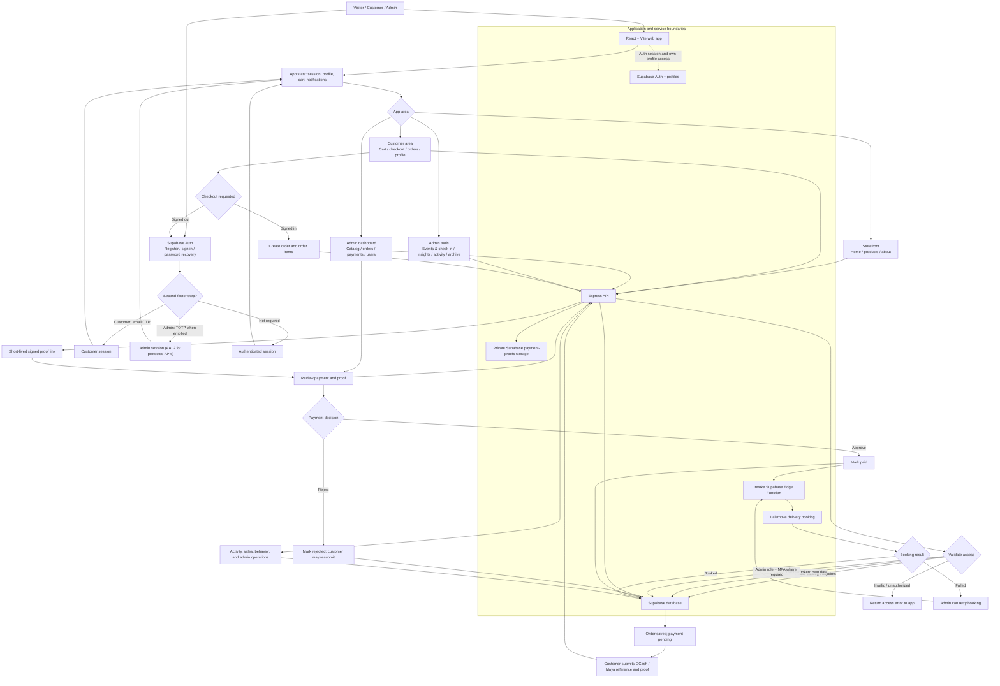

# FITCHEQUE Project Flowchart

This is a high-level skeleton of the current application and its main data
flows. It omits individual screens and API endpoints so the diagram stays
readable as the project evolves.

## Key boundaries

- The browser uses Supabase Auth and the public/anon key. Business data flows
  through the Express API.
- The Express API validates the user's token and role, then accesses Supabase
  using its server-side service-role key.
- Payment proof files stay in a private storage bucket; admins receive
  short-lived signed links for review.
- Payment approval and delivery booking are separate steps. A failed delivery
  booking does not undo payment approval and can be retried by an admin.
